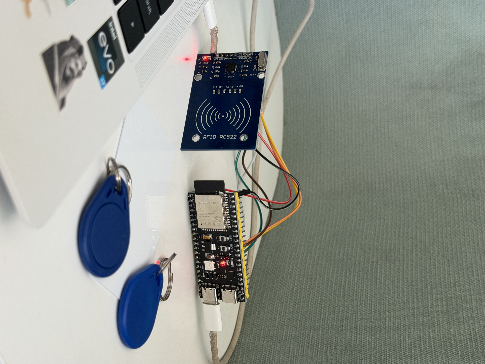
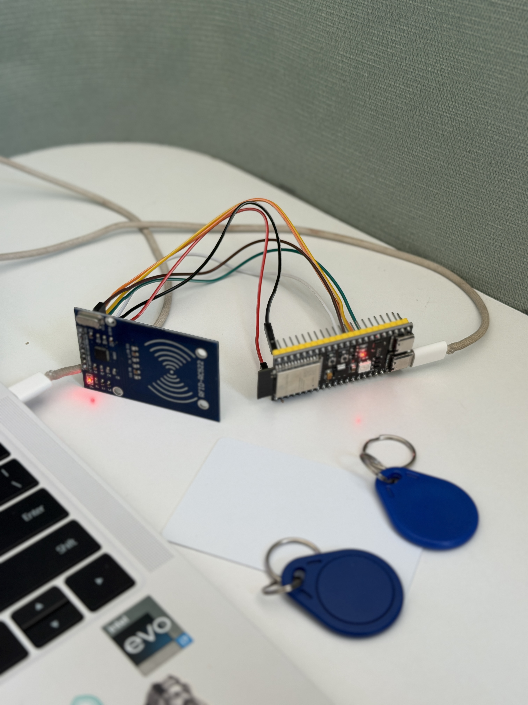
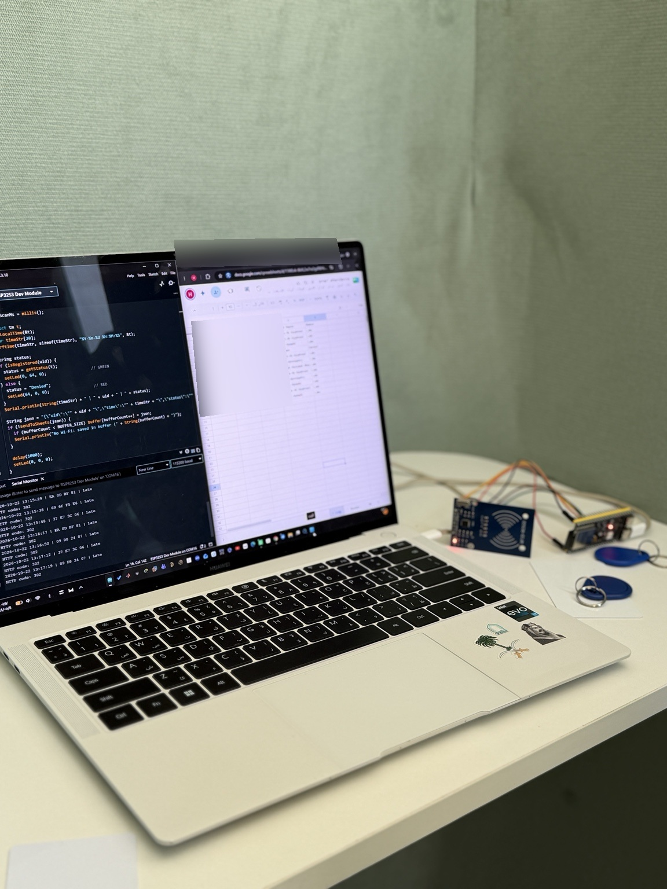

Smart Attendance System

Project Overview

A smart attendance system developed using ESP32-S3 and RFID technology to identify users and record attendance timestamps automatically.

The system uses Wi-Fi connectivity to send attendance records to Google Sheets through Google Apps Script. It also includes a Looker Studio dashboard for attendance visualization and Telegram notifications for unregistered RFID cards.

Technologies & Components

* ESP32-S3
* RFID RC522
* Wi-Fi
* Google Apps Script
* Google Sheets
* Looker Studio
* Telegram Notifications

My Contributions

I worked as part of the project team, focusing on hardware setup and system integration, including connecting the ESP32-S3 with the RFID RC522 module and contributing to the integration of the system components.

Project Status

Successfully implemented and tested.

Hardware Setup

The prototype integrates an ESP32-S3 microcontroller with an RFID RC522 reader for card-based identification.

Hardware Connection

System Workflow

1. RFID Identification: The RFID RC522 reader scans the user’s RFID card.
2. Microcontroller Processing: The ESP32-S3 reads the card ID and processes the attendance data.
3. Wi-Fi Communication: The ESP32-S3 sends the attendance information through Wi-Fi.
4. Cloud Integration: Google Apps Script processes the incoming data and records it in Google Sheets.
5. Data Visualization: Looker Studio displays attendance records through a dashboard.
6. Notifications: Telegram notifications are sent when an unregistered RFID card is detected.

## Project Demo

[Watch the Smart Attendance System Demo](./video-output-A8434B87-ED92-4ACE-8A08-EF362B0F0A09-1.mov)

Demo video showing the system in operation.

## Project Highlights

- **Automated Attendance:** Identifies users through RFID cards and records attendance timestamps.
- **IoT Connectivity:** Uses ESP32-S3 and Wi-Fi to transmit attendance data.
- **Cloud Integration:** Connects the hardware system to Google Sheets through Google Apps Script.
- **Data Visualization:** Presents attendance records through a Looker Studio dashboard.
- **Real-Time Notifications:** Sends Telegram alerts when an unregistered RFID card is detected.
- **Tested Prototype:** Successfully implemented and tested as a working system.

My Contributions

* Implemented Wi-Fi connectivity for the ESP32-S3.
* Worked on HTTPS data transmission to Google Apps Script and Google Sheets.
* Contributed to hardware setup and system integration.
* Prepared and delivered the final project presentation and live demonstration.
* Contributed to the technical project report.
